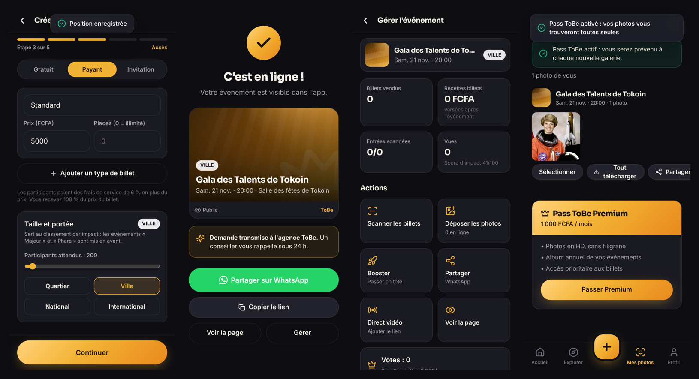

# ToBe — Sois-y. Retrouve-toi.

La plateforme des événements de Lomé et d'Afrique de l'Ouest : découvrir les événements classés par impact, prendre ses billets en Mobile Money, voter, contribuer aux cagnottes, et **retrouver ses photos grâce à son visage** (Pass ToBe). Les organisateurs publient en 2 minutes et peuvent **confier l'organisation à l'agence ToBe** d'une case à cocher.

## Ce que contient le dépôt

| Dossier | Rôle |
| --- | --- |
| `packages/core` | Toute la logique métier (comptes, événements, impact, billets, votes, cagnottes, photos, demandes ToBe, revenus) et la table des routes de l'API. Testée. |
| `server` | L'API Node.js (Express) avec stockage SQLite intégré à Node, envoi d'images, limite anti-abus sur les SMS. Sert aussi l'application web. |
| `web` | L'application mobile (React, Tailwind) : PWA installable, prête pour Capacitor (Android / iOS). |

Le même code métier tourne côté serveur et, en **mode démo**, directement dans le navigateur : c'est ce qui permet de publier une démo complète sans serveur.

## Fonctionnalités

- **Connexion par téléphone** (+228) et code SMS, sans mot de passe.
- **Accueil** : à la une (événements boostés), ce week-end, votes en cours, les plus marquants.
- **Explorer** : recherche, catégories, dates, gratuit/payant, tri par date ou par impact, **carte** OpenStreetMap.
- **Classement par impact** : score sur 100 (taille, portée, type, engagement réel) → badges Local, Ville, Majeur, Phare.
- **Création en 5 étapes** : infos et affiche · visibilité (public, non listé, privé avec code ou liste d'invités) · accès (gratuit, payant avec plusieurs billets, invitation) · options (votes, cagnotte, galerie, direct vidéo, boost) · **« Confier l'organisation à ToBe »** (complète, à la carte, devis).
- **Billetterie** : Mixx by Yas, Moov Money, carte ; frais de service 6 % (4 % pour les organisateurs Pro) ; billet QR code disponible hors connexion ; **scanner** d'entrée (caméra ou saisie).
- **Votes** gratuits, payants ou mixtes, packs (1 / 10 / 50), jury + public, résultats en direct / top 3 / à la fin, **certificat de transparence** avec empreinte des votes.
- **Cagnottes** : Mobile Money ou carte (diaspora), livre d'or, contributions anonymes.
- **Pass ToBe** : reconnaissance faciale **dans le navigateur** (le selfie ne quitte pas le téléphone, seule une empreinte de 128 nombres est envoyée), notification automatique quand une nouvelle galerie vous contient, option « ne jamais me montrer », suppression des données, téléchargement avec filigrane (HD sans filigrane en Premium).
- **Espace organisateur** : ventes, recettes, entrées scannées, ventes par jour, dépôt des photos, boost, direct vidéo, candidats.
- **Annuaire des prestataires** avec badge « Certifié ToBe » et demandes de devis.
- **Espace agence ToBe** : demandes « Confier à ToBe » avec suivi (nouveau → contacté → devis → signé), revenus de la plateforme par source.

> Les paiements sont **simulés** dans cette version : aucun montant n'est débité. Le branchement d'un agrégateur Mobile Money se fait dans `packages/core/src/service.ts` (méthode `pay`).

## Démarrer en local

```bash
npm install
npm run dev          # API sur :8787 + application sur :5173
npm test             # tests de la logique métier et de l'API
```

En développement, le code SMS s'affiche à l'écran.

## Mettre en ligne sur tobe.eledji.com

### Option 1 — Démo immédiate (GitHub Pages)
Le workflow `.github/workflows/pages.yml` publie la version de démonstration à chaque push sur `main`.
1. Dans GitHub : **Settings → Pages → Source : GitHub Actions**, domaine personnalisé `tobe.eledji.com`.
2. Chez votre hébergeur DNS : un enregistrement **CNAME** `tobe` → `semhat.github.io`.

En démo, les données sont gardées dans le navigateur de chaque visiteur (code SMS de démo : `123456`). Idéal pour présenter le projet ; pour de vrais utilisateurs, prendre l'option 2.
GitHub Pages sur un dépôt **privé** demande un compte GitHub payant ; sinon, rendre le dépôt public.

### Option 2 — Production (serveur)
Une seule image Docker sert l'API et l'application :
```bash
docker build -t tobe .
docker run -p 8787:8787 -v tobe-data:/data -e ADMIN_PHONES=+228XXXXXXXX -e EXPOSE_OTP=false tobe
```
Ou en un clic sur Render avec `render.yaml` (disque persistant inclus). Pointez ensuite `tobe.eledji.com` vers le service (CNAME). Variables : voir `server/.env.example`.

## Application Android / iOS (Capacitor)
```bash
cd web
VITE_API_URL=https://tobe.eledji.com npm run build
npm i -D @capacitor/cli @capacitor/core @capacitor/android @capacitor/ios
npx cap add android && npx cap add ios
npx cap sync && npx cap open android
```

## À brancher pour la production
- **SMS** : `SMS_WEBHOOK_URL` (passerelle d'opérateur ou fournisseur SMS).
- **Paiements** : agrégateur Mobile Money (Mixx by Yas, Moov Money, cartes) avec confirmation par webhook.
- **Juridique** : conditions d'utilisation, politique de confidentialité, déclaration du traitement des données biométriques auprès de l'autorité togolaise de protection des données, validation du format des votes payants.

## Aperçu



