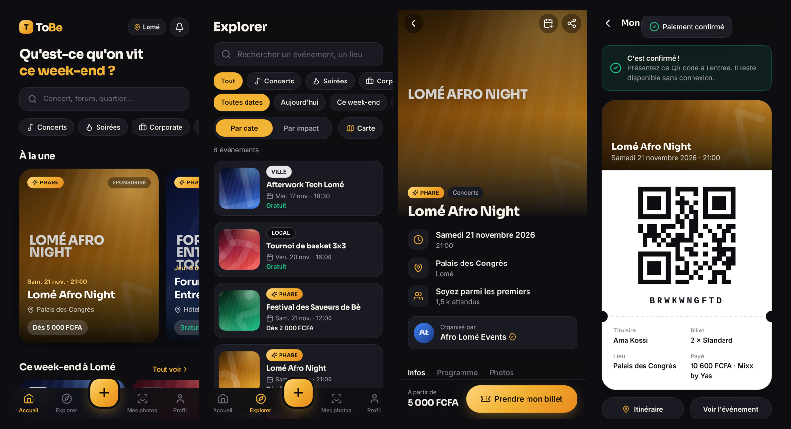
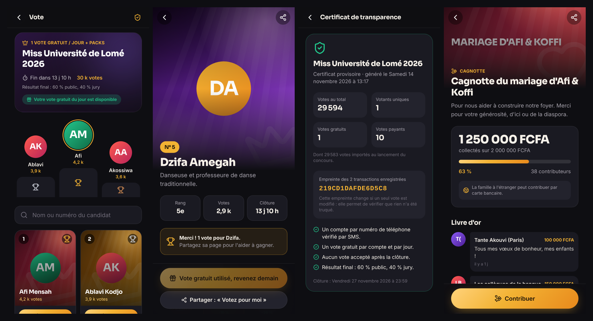

# ToBe — Sois-y. Retrouve-toi.

La plateforme des événements de Lomé et d'Afrique de l'Ouest : découvrir les événements classés par impact, réserver ses places, voter, contribuer aux cagnottes, et **retrouver ses photos grâce à son visage** (Pass ToBe). Les organisateurs publient en 2 minutes et peuvent **confier l'organisation à l'agence ToBe** d'une case à cocher.

## Ce que contient le dépôt

| Dossier | Rôle |
| --- | --- |
| `packages/core` | Toute la logique métier (comptes, événements, impact, billets, votes, cagnottes, photos, demandes ToBe, revenus) et la table des routes de l'API. Testée. |
| `server` | L'API Node.js (Express) avec stockage SQLite intégré à Node et envoi d'images. Sert aussi l'application web (hébergement serveur). |
| `api` | La même API en fonction Vercel : données dans Postgres (Neon), images dans Vercel Blob. C'est ce qui tourne sur tobe.eledji.com. |
| `web` | L'application mobile (React, Tailwind) : PWA installable, prête pour Capacitor (Android / iOS). |

Le même code métier tourne côté serveur et, en **mode démo**, directement dans le navigateur : c'est ce qui permet de publier une démo complète sans serveur.

## Fonctionnalités

- **Connexion avec Google** ou **par e-mail** (code à 6 chiffres envoyé par Resend), sans mot de passe.
- **ToBe Club** : bonus du jour avec série, roue du jour, quiz quotidien sur Lomé et le Togo, missions, parrainage, niveaux, classement du mois et récompenses (boost, Premium, badge, lots ajoutés par l'agence). Tous les tirages et réponses sont vérifiés côté serveur.
- **Rappels et notifications push** (comme WhatsApp) : bouton « Me rappeler » sur chaque événement et rappels automatiques à chaque billet, 2 jours avant, la veille, le jour J (8 h) et 30 minutes avant. Les clés VAPID sont créées automatiquement et gardées dans la base. La tâche planifiée `.github/workflows/rappels.yml` appelle `/api/cron/reminders` toutes les 5 minutes.
- **Installation de l'application** : fenêtre « Installez ToBe » (Android, ordinateur) et mode d'emploi pour iPhone (Partager → Sur l'écran d'accueil). Sur iPhone, les notifications ne marchent qu'une fois l'application ajoutée à l'écran d'accueil.
- **Équipe d'un événement** : l'organisateur invite par lien WhatsApp un co-organisateur, des contrôleurs d'entrée (scan des billets) et des photographes ; chacun n'a que les droits de son rôle.
- **Équipe ToBe** : super administrateur (ADMIN_EMAILS), administrateur, chef de projet (dossiers « Confier à ToBe » qui lui sont attribués), modérateur, marketing (ToBe Club), support (lecture seule). Invitations par lien WhatsApp.
- **Pass ToBe guidé** : caméra en direct qui vérifie cadrage, lumière et netteté, puis capture 3 angles (face et profils) ; le mouvement de tête écarte les photos de photos.
- **Accueil** : à la une (événements boostés), ce week-end, votes en cours, les plus marquants.
- **Explorer** : recherche, catégories, dates, gratuit/payant, tri par date ou par impact, **carte** OpenStreetMap.
- **Classement par impact** : score sur 100 (taille, portée, type, engagement réel) → badges Local, Ville, Majeur, Phare.
- **Création en 5 étapes** : infos et affiche · visibilité (public, non listé, privé avec code ou liste d'invités) · accès (gratuit, payant avec plusieurs billets, invitation) · options (votes, cagnotte, galerie, direct vidéo, boost) · **« Confier l'organisation à ToBe »** (complète, à la carte, devis).
- **Billetterie** : Mixx by Yas, Moov Money, carte ; frais de service 6 % (4 % pour les organisateurs Pro) ; billet QR code disponible hors connexion ; **scanner** d'entrée (caméra ou saisie).
- **Votes** gratuits, payants ou mixtes, packs (1 / 10 / 50), jury + public, résultats en direct / top 3 / à la fin, **certificat de transparence** avec empreinte des votes.
- **Cagnottes** : Mobile Money ou carte (diaspora), livre d'or, contributions anonymes.
- **Pass ToBe** : reconnaissance faciale **dans le navigateur** (le selfie ne quitte pas le téléphone, seule une empreinte de 128 nombres est envoyée), notification automatique quand une nouvelle galerie vous contient, option « ne jamais me montrer », suppression des données, téléchargement avec filigrane (HD sans filigrane en Premium).
- **Espace organisateur** : ventes, recettes, entrées scannées, ventes par jour, dépôt des photos, boost, direct vidéo, candidats.
- **Annuaire des prestataires** avec badge « Certifié ToBe » et demandes de devis.
- **Espace agence ToBe** : demandes « Confier à ToBe » avec suivi (nouveau → contacté → devis → signé), revenus de la plateforme par source.

> **Paiement en ligne désactivé** pour le lancement (`PAYMENTS_ENABLED` absent) : les billets sont **réservés** et réglés à l'entrée ; votes payants, cagnottes, boosts et abonnement Pro affichent « bientôt ». Le branchement d'un agrégateur Mobile Money se fait dans `packages/core/src/service.ts` (méthode `pay`), puis `PAYMENTS_ENABLED=true`.

## Démarrer en local

```bash
npm install
npm run dev          # API sur :8787 + application sur :5173
npm test             # tests de la logique métier et de l'API
```

En local, `SEED=true` charge des données d'exemple et `EXPOSE_OTP=true` affiche le code de connexion à l'écran. Jamais en production.

## Mettre en ligne sur tobe.eledji.com

### Production actuelle — Vercel
Réglages du projet Vercel (déjà faits) : racine du dépôt, install `npm ci`, build `npm run build:vercel`, sortie `dist`, Node 22. Chaque push sur `main` redéploie.

Variables d'environnement :
| Variable | Rôle |
| --- | --- |
| `DATABASE_URL` | Postgres Neon (ajoutée par l'intégration Neon) |
| `BLOB_READ_WRITE_TOKEN` | Vercel Blob pour les affiches et photos |
| `RESEND_API_KEY`, `RESEND_EMAIL_DOMAIN` | Envoi des codes de connexion (expéditeur `connexion@eledji.com`, ou `EMAIL_FROM`) |
| `GOOGLE_CLIENT_ID` | Facultatif : client OAuth Google (par défaut, celui de ToBe dans le projet Google Cloud ELEDJI) |
| `ADMIN_EMAILS` | E-mails ayant accès à l'espace agence ToBe (séparés par des virgules) |
| `PAYMENTS_ENABLED` | `true` uniquement quand le paiement Mobile Money est branché |

DNS chez Namecheap : CNAME `tobe` → Vercel ; enregistrements Resend (`resend._domainkey`, `rsend`, `send`, `_dmarc`). L'offre gratuite de Resend envoie 100 e-mails par jour (3 000 par mois).

### Alternative — serveur (Docker)
Une seule image Docker sert l'API et l'application :
```bash
docker build -t tobe .
docker run -p 8787:8787 -v tobe-data:/data -e ADMIN_EMAILS=vous@exemple.com -e RESEND_API_KEY=re_xxx tobe
```
Ou en un clic sur Render avec `render.yaml` (disque persistant inclus). Pointez ensuite `tobe.eledji.com` vers le service (CNAME). Variables : voir `server/.env.example`.

## Application Android / iOS (Capacitor)
```bash
cd web
VITE_API_URL=https://tobe.eledji.com npm run build
npm i -D @capacitor/cli @capacitor/core @capacitor/android @capacitor/ios
npx cap add android && npx cap add ios
npx cap sync && npx cap open android
```

## À brancher pour la production
- **Paiements** : agrégateur Mobile Money (Mixx by Yas, Moov Money, cartes) avec confirmation par webhook.
- **Juridique** : conditions d'utilisation, politique de confidentialité, déclaration du traitement des données biométriques auprès de l'autorité togolaise de protection des données, validation du format des votes payants.

## Aperçu




